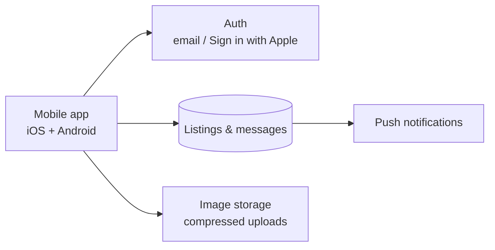

# chadito-showcase
About : Classifieds marketplace for Chad: cars, housing, jobs, phones &amp; local services. Live on iOS and Android. Topics : react-native expo firebase marketplace classifieds real-time-chat chad africa mobile-app
# Chadito

> The classifieds app dedicated to Chad: buy, sell and find deals near you, from cars and housing to jobs and local services.

**Status:** 🟢 Live on iOS and Android · 500+ downloads on Google Play · 4.8★

## Screenshots

   

## What you can find

Cars · Houses and apartments for rent · Land · Phones and electronics · Jobs (N'Djamena and the provinces) · Local businesses and services

## Features

**Buy & sell**
- Free listings with up to 10 photos, compressed on the device to save mobile data
- Simple search by city
- Guest mode: browse without an account
- Sign in with Apple

**Real-time messaging**
- Private chat between buyer and seller, with read receipts
- Photos in chat, listing pinned at the top of the conversation
- Push notifications that open the right conversation
- Unread conversations pinned to the top of the inbox

**Trust & safety**
- Merchant identity verification (KYC) with a "Verified Seller" badge
- 1 to 5 star seller ratings and reviews, "Reliable Seller" and "Top Seller" badges
- Reporting system for suspicious listings and users

**For merchants**
- Personalized storefront (logo and cover photo)
- Pro dashboard: listings, job offers and events in one place
- "Event / Promotion" listing format with built-in date scheduling
- Subscribe to favorite sellers; share a seller profile with a QR code

**Platform**
- Dark mode and fully redesigned UI
- French, English and Arabic

## Tech stack

React Native · Expo · TypeScript · Firebase [À CONFIRMER : Auth, base de données, stockage, push]

## Architecture

[À AJUSTER selon ta vraie architecture]

## My role

Co-founder and lead engineer: product, mobile architecture, development and releases on both stores. [À CONFIRMER]

> Source code is private. Contact me for a technical walkthrough: nourdevtd@gmail.com
